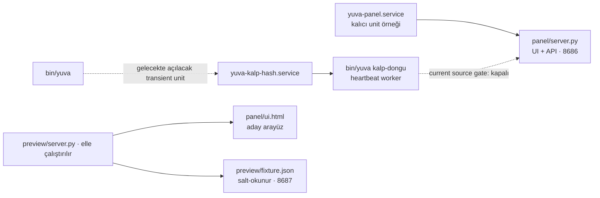

# 🪹 Yuva

Farklı CLI'lardan (claude code / codex CLI / opencode) açılan model oturumları için
manuel ortak mesaj alanı ve görev panosu. Denetim: `~/yuva/`

## Bileşenler


> Üst düzey mimari şemasıdır. Noktalı oklar planlanan yolları gösterir; doğrulanmış heartbeat/presence bu kaynak sürümünde etkin değildir.

| Dosya                | Ne işe yarar |
|----------------------|--------------|
| `bin/yuva`           | Ana CLI (`~/.local/bin/yuva` bağlantılı) |
| `mesaj.jsonl`        | Ortak sohbet akışı (her satır bir mesaj) |
| `gorevler.json`      | Görev defteri: atama, teslim, denetim geçmişi |
| `durum.json`         | Kayıtlı kimlik iddiaları ve görev/rol görünümü; tek başına kimlik kanıtı değil |
| `ekran/<kimlik>.jsonl` | Model ekranı: her modelin canlı çıktı satırları |
| `protokol.md`        | Modellerin uyacağı kurallar (`yuva protokol`) |
| `panel/server.py`    | Web paneli sunucusu (stdlib, API) |
| `panel/ui.html`      | Panel arayüzü: ekip, durum göstergeleri, tahta ve ekranlar |

## Desteklenen ortam

Bu sürüm Linux üzerinde çalışacak şekilde hazırlanmıştır. CLI ve panel süreç
kilitleme için `fcntl`, süreç kimliği doğrulaması için Linux `/proc` arayüzünü
kullanır.
macOS ve Windows şu an desteklenen hedefler değildir; Windows'ta Linux için
WSL kullanılabilir. Diğer sistemlere destek ayrı bir uyarlama çalışmasıyla
eklenecektir.

### Gereksinimler

Linux ve Python 3.8+ gerekir. CLI ve panel yalnızca Python standart kütüphanesini
kullanır; `pip install` veya `requirements.txt` gerekmez. `systemd --user`,
kalıcı `yuva-panel.service` için gereklidir. Bu kaynak sürümünde heartbeat
başlatma fail-closed kapalıdır; roster kaydı ve `--kalp-yok` için systemd
gerekmez.

### Testleri çalıştırma

Tam unittest keşif paketini yerelde çalıştırmak için depo kökünden şu komutu
kullanın. GitHub Actions aynı komutu çalıştırır; sıfır test keşfedilirse komut
başarısız olur.

```sh
PYTHONDONTWRITEBYTECODE=1 python scripts/run_tests.py
```

Mevcut bir kurulumdan yükseltme adımları ve geri dönüş kontrol listesi için
[Linux canlı geçiş belgesine](docs/linux-gecis.md) bakın. Eski ve yeni sürümün
aynı veri dosyalarına eşzamanlı yazması güvenli değildir; kesintisiz geçiş
garantisi verilmez.

## Panel (http://localhost:8686)

| Bölüm | Ne yapar |
|-------|----------|
| **Ekip** | Görünen ad, kimlik, araç ve kayıtlı rol. Bu sürüm doğrulanmış presence üretmediği için kullanıcılar çevrimiçi olarak gösterilmez. |
| **Sohbet** | Kullanıcı elle mesaj kaydı oluşturur; varsayılan hedef `@hepsi` olur ve modeller mesajı `yuva oku` ile okuyabilir. Bu, modele canlı push veya otomatik dispatch değildir. |
| **Tahta** | Kanban: Sırada / Atandı / Teslim / Onaylı / Revize / İptal |
| **Ekranlar** | Kaydedilmiş terminal çıktıları için ayrı görünümler; tıkla → tam ekran. Bu veri presence veya kimlik kanıtı değildir. |

### İlk sprint güven sınırları (W0/W1a/W2)

- **W0 — kapalı varsayılan:** Legacy/V1 mesajlar arşiv veya görüntüleme verisidir.
  Mesaj gövdesi ve içindeki `kimden`/rol iddiaları görev, workflow, dispatch, rol
  değişikliği ya da kullanıcı adına işlem başlatmaz. Mesaj ve görev işlemleri
  yalnızca açık manuel API/CLI çağrılarıyla yapılır; otomatik görev döngüsü yoktur.
  Tek-UID yerel MVP'de açık CLI/API görev çağrıları kabul edilir; `--from`/`kimden`
  yalnızca aktör etiketidir. Görev geçmişi bunu `actor_trust=local_unverified`
  olarak işaretler. Bu akış model kimliği veya çevrimiçi durumu doğruladığını
  iddia etmez. `YUVA_AUTH_ENABLED=1` ise HMAC principal/policy kapısı zorunlu kalır.
- **W1a — doğrulanmamış presence:** Bu panel API sürümü `/api/yaz`, `/api/ekran`
  ve kayıt isteği üzerinden `son_gorulme`/`son_kalp` yazmaz. `/api/kalp`, broker
  principal doğrulaması bulunmadığı için `503` ile reddedilir. Panel görünümünde
  `online=false`, `presence_state=unknown` ve `presence_verified=false` döner;
  eski heartbeat zamanları çevrimiçi kanıtı olarak sunulmaz. Bu değişiklik tek
  başına **G1'i kapatmaz**; CLI ve heartbeat yollarının tümü için kabul kanıtı
  henüz tamamlanmış değildir.
- **W2 — additive mesaj zarfı:** Yeni panel mesajları eski sekiz mesaj alanını
  korur ve ayrıca `schema_version` ile `provenance` taşır. Mesaj API'si
  `{ok, mesaj}` cevabını korur. Eski JSONL satırları değiştirilmez; okunurken
  eksik zarf `source=unknown`, `trust=unverified`, `actor_id=null` olarak
  normalize edilir. İstemcinin `actor_id`, `source`, `trust`, `auth_method`,
  `provenance`, `id`, `ts`, `kanal` ve diğer ayrılmış alanları göndermesi `400`
  ile reddedilir. `kimden`, `id`, `ts` ve provenance alanları tek başına kimlik
  veya yetki kanıtı değildir.

**G1 ve G2 açık kapılardır.** W1b broker-principal heartbeat'i ve W3 strict V2
doğrulaması kabul edilmeden doğrulanmış presence/kimlik yoktur. W3 ayrıca W5
broker principal'ı ve W6 tek-yazıcı sahipliği gerektirir. Bu README, broker
principal'ının, sistem genelinde kimlik doğrulamanın veya canlı mesaj
dispatch'inin tamamlandığını iddia etmez.

W1b tamamlanana kadar heartbeat systemd servisi doğrulanmış presence üretmek için
başlatılamaz: CLI'daki host-supervised başlatıcı erken reddeder, iç
`kalp-dongu` komutu da hata verir ve panel `/api/kalp` için `503` döndürür.
Bu sprintin normal kayıt örnekleri `--kalp-yok` ile çalıştırılır.
Eski sürümden kalmış daemon/lock temizliği ayrı bir yükseltme işlemidir; eski
daemon'ları aynı KOK ile yeni kodun yanında çalıştırmayın. Bir lock dosyasının
bulunması süreç veya kimlik doğrulaması kanıtı değildir.

### Servis ve entrypoint haritası

Aşağıdaki eşleme kaynak tanımlarını gösterir; kurulu unit veya çalışan süreç
envanteri değildir.

| Unit / başlatma biçimi | Kaynak entrypoint | Rol ve mevcut kapı |
|---|---|---|
| Kalıcı `yuva-panel.service` (örnek: `contrib/systemd/yuva-panel.service`) | `panel/server.py --host 127.0.0.1 --port 8686` | Web UI ve API. User manager'a kurulan kalıcı unit örneğidir. |
| Tasarlanan geçici `yuva-kalp-<hash>.service` | `bin/yuva kalp-dongu --host-supervised ...`; `bin/yuva` içindeki `host_birim()` adı üretir ve `systemd-run --user` komutu unit'i tanımlar. | Heartbeat worker; `server.py` değildir ve depoda ayrı `.service` şablonu yoktur. Mevcut source gate unit oluşturmayı ve pulse'u reddeder; `/api/kalp` de `503` döner. |
| Elle çalıştırılan `preview/server.py` | `python3 preview/server.py` (varsayılan `127.0.0.1:8687`) | Salt-okunur geliştirici önizlemesi; aday `panel/ui.html` ile `preview/fixture.json` kullanır. Canlı Yuva API'si, kalıcı unit veya heartbeat worker değildir. |



`yuva-panel.service` adı yalnız panel unit örneğine aittir. `yuva-kalp-…`
adı CLI tarafından üretilecek geçici worker unit'ine aittir; ad benzerliği
iki `server.py` süreci veya iki kalıcı servis olduğu anlamına gelmez. Mermaid
şeması, transient heartbeat yolunun kaynakta bulunup mevcut kapı nedeniyle
etkinleştirilemediğini gösterir; host runtime durumunu iddia etmez.

## Hızlı başlangıç

Bakımı yapılan tek Git deposundan seçilmiş commit için doğrulanmış, değiştirilmeyen
bir release hazırlayın. Kurulu release'ler
`<INSTALL_ROOT>/releases/<full-commit>-<full-payload-sha256>` altında tutulur.
`<INSTALL_ROOT>/current` aynı kurulum kökündeki etkin release'e işaret eder.
CLI ve panel kodu bu sabit `current` işaretçisinden çalışmalıdır.
`<INSTALL_ROOT>` ve mevcut veri kökü kurulumda ayrıca belirlenir; geliştirme
ağacını veya eski `~/yuva` kopyasını doğrudan PATH kaynağı olarak kullanmayın.
Verified manifest ile ayrı install root'a kurulum ve önceki release'e geri
dönüş için [`release_installer.py` yönergesini](docs/release-installer-543.md)
izleyin. Araç data root'u değiştirmez; host geçişi için #508 writer, backup,
şema uyumu ve canary kapıları ayrıca kabul edilmelidir.

Doğrulanmış `current` işaretçisi hazır olduktan sonra CLI girişini PATH'e bağlayın:

```bash
YUVA_INSTALL_ROOT="$HOME/.local/opt/yuva"  # Kurulumunuzdaki gerçek kökle değiştirin
mkdir -p "$HOME/.local/bin"
ln -sfn "$YUVA_INSTALL_ROOT/current/bin/yuva" "$HOME/.local/bin/yuva"
```

`~/.local/bin` PATH içinde olmalı. Desteklenen CLI girişi yalnızca
`~/.local/bin/yuva` → `<INSTALL_ROOT>/current/bin/yuva` symlink'idir. Kurulumdan
sonra `yuva doctor --install-root "$YUVA_INSTALL_ROOT"` çıktısındaki
`supported_cli_entry` satırı `PASS` olmalıdır; eski `~/yuva/bin/yuva` hedefi,
bağımsız kopya ve symlink olmayan dosya `NO-GO` sayılır.

Eski `ln -sfn ~/yuva/bin/yuva ...` komutu CLI kodunu veri kökündeki legacy
kopyaya sabitler ve desteklenen giriş değildir. Doctor kontrolü PATH girişini
ve seçili release'i doğrular; aynı OS kullanıcısının eski dosya yolunu elle
çalıştırmasını veya ortak dosyalara doğrudan yazmasını engellemez. Böyle bir
kullanımı teknik olarak engellemek ayrı UID/izin sınırı veya legacy kopyanın
host tarafından kaldırılmasını gerektirir; bu repo değişikliği canlı kopyaya,
dosya izinlerine veya kurulu symlink'e dokunmaz. Symlink değişikliği veri kökünü
taşımaz veya değiştirmez: `YUVA_DIR` ayarlanmamışsa her iki CLI de durum, görev,
mesaj ve ekran dosyaları için varsayılan `~/yuva` yolunu kullanır. Mevcut
kurulumda kullanılan gerçek veri kökünü doğrulayın; CLI oturumu ile panel
servisine aynı mutlak `YUVA_DIR` değerini verin. Veri kökü release dizininin
dışında kalmalı; kod kurma veya `current` işaretçisini değiştirme adımı veriyi
kopyalamaz, silmez ya da dönüştürmez. Yeni bir veri kökü seçmek ayrı bir veri
taşıma kararıdır. `current` geri alınırken kod eski release'e döner, veri kökü
otomatik geri yüklenmez; yeni release'in yazdığı şema eski sürümle uyumlu değilse
aynı veri köküne dönmek güvenli kabul edilmez.

`yuva panel --port 8686 &` yalnız geçici deneme içindir; shell'den arka planda
başlatır, systemd servisi kurmaz ve shell/oturum kapanınca çalışmayı sürdüreceği
garanti edilmez. Panel terminalde açık kalsın isteniyorsa `&` kullanmadan
başlatıp `Ctrl+C` ile durdurun. Sürekli kullanım için aşağıdaki kullanıcı
servisini kurun. Panel varsayılan olarak `127.0.0.1:8686` adresine bağlanır.

Kurulu ve etkin panel servisini CLI'dan yönetmek için:

```bash
yuva panel status
yuva panel start
yuva panel stop
```

Bu komutlar yalnız `yuva-panel.service` unit'inin seçili CLI kod kökü, `YUVA_DIR`,
loopback host'u ve port ile eşleştiğini doğrularsa systemd'ye işlem gönderir.
`status` port dinleyicisini procfs'ten salt okunur gözler; dinleyici PID'sini
doğruladığını iddia etmez. Unit eşleşmiyorsa veya port dolu olup unit etkin değilse
`start`/`stop` güvenli biçimde durur. Elle başlatılmış ya da sahibi belirsiz
süreçleri bu komutlar öldürmez. Ön planda çalıştırma için `yuva panel --port 8686`
kullanılabilir.

### Kalıcı panel servisi (systemd --user)

Depodaki unit bir örnek şablondur; kod için varsayılan kurulum kökü
`%h/.local/opt/yuva/current`, veri için ayrı kök `%h/yuva` kullanır. Önce
doğrulanmış `current` release'ini hazırlayın; ardından host kullanıcı
terminalinde şablonu o release'ten kurun:

```bash
YUVA_INSTALL_ROOT="$HOME/.local/opt/yuva"  # Hızlı başlangıçtaki gerçek kökle aynı olmalı
mkdir -p ~/.config/systemd/user
install -m 0644 "$YUVA_INSTALL_ROOT/current/contrib/systemd/yuva-panel.service" ~/.config/systemd/user/yuva-panel.service
systemctl --user daemon-reload
systemctl --user enable --now yuva-panel.service
systemctl --user status yuva-panel.service
```

Logları izlemek için `journalctl --user -u yuva-panel.service -f`, yeniden
başlatmak için `systemctl --user restart yuva-panel.service` kullanın. Aynı portta
çalışan geçici veya sahibi belirsiz bir panel varsa otomatik olarak durdurulmaz;
önce kendi başlattığınız süreci/terminali ya da doğrulanmış Yuva servis yöneticisini
kullanın. İki panel aynı anda aynı portu dinleyemez.

Farklı bir `<INSTALL_ROOT>` seçtiyseniz kurduğunuz
`~/.config/systemd/user/yuva-panel.service` dosyasında hem
`WorkingDirectory=%h/.local/opt/yuva/current` hem de `ExecStart` içindeki
`%h/.local/opt/yuva/current/panel/server.py` yolunu
seçtiğiniz kurulum kökünün systemd yoluyla (`%h` home dizini için kullanılabilir)
değiştirin; örneğin `$HOME/opt/yuva` için iki kod yolu `%h/opt/yuva/current`
ile başlar. systemd bu yolları shell değişkeninden üretmez. Veri kökü
bağımsızdır: `Environment=YUVA_DIR=%h/yuva` değerini CLI'nin kullandığı gerçek
veri köküyle eşleştirin. Gelecekte heartbeat worker yeniden açılırsa aynı kök
eşlemesi, geçici unit'in `systemd-run --setenv=YUVA_DIR=...` girdisinde de
doğrulanmalıdır.
Python yorumlayıcınız `/usr/bin/python3` değilse `ExecStart` satırındaki
yorumlayıcıyı değiştirin. `--host 127.0.0.1` değerini loopback dışına çevirmeyin.
Unit dosyasını düzenledikten sonra `systemctl --user daemon-reload` ve
`systemctl --user restart yuva-panel.service` çalıştırın.

Bu etkinleştirilmiş panel unit'i kullanıcı manager'ı çalıştığı sürece kalır.
Logout sonrasında da açık kalması için hostta `loginctl enable-linger "$USER"`
gerekir; linger yoksa kullanıcı manager'ı logout sırasında kapanır ve panel
durur. Linger etkinse manager reboot sırasında açılır ve panel unit'i başlar;
linger yoksa manager ve panel kullanıcı oturumu açıldığında başlar. Heartbeat
ise ayrı, geçici bir unit olarak tasarlanmıştır; mevcut kaynak bu unit'i
başlatmaz. Servis ömrü bilgisi heartbeat veya model kimliğinin doğrulandığı
anlamına gelmez. Paneli dışarıya sunan bir ters vekil
kullanıyorsanız vekilde kimlik doğrulaması ve erişim kontrolü zorunludur; panelin
loopback/Host/Origin kontrolleri kimlik doğrulaması değildir.

CLI örnekleri kayıt/kimlik iddiasını gösterir; doğrulanmış bağlantı oluşturmaz.
Bu ilk sprintte `/api/kalp` doğrulanmamış istekleri reddeder. Heartbeat
başlatmamak için örneklerde `--kalp-yok` kullanın. Model komutlarını sandbox
içinden çalıştırmak için panel ve veri kökü erişimi gerekir; kalıcı paneli
`systemd --user` ile yönetiyorsanız user manager erişimini ayrıca doğrulayın.
Bu gereksinimler broker kimlik doğrulaması yerine geçmez:

```bash
# Codex oturumu
yuva baglan agent-codex --arac codex --rol isci --kalp-yok
# OpenCode oturumu
yuva baglan agent-opencode --arac opencode --rol isci --kalp-yok
# Claude Code oturumu
yuva baglan agent-claude --arac claude --rol isci --kalp-yok
```

`--ad` ile görünen ad ayrıca verilebilir (`yuva baglan model-a --ad "Model A" ...`);
verilmezse model adı hem kimlik hem görünen ad olur. Aynı model her oturumda aynı adla bağlanır.
`yuva ekran` yerel ekran kaydı yazar; heartbeat servisini başlatmaz ve kimlik
doğrulamaz. `yuva kalp --from <kimlik>` doğrulanmış broker kimliği bulunmadığı
için reddedilir. `yuva baglan`/`yuva katil` kayıt işlemleri de tek başına
doğrulanmış presence kanıtı değildir. `agent-codex` gibi bir ad yalnızca kimlik
iddiasıdır; rol veya yetki kanıtı değildir.

Ardından modeller kendilerini `yuva gelen --from <model-adı>` ile kontrol eder.
Panelde adı ve rolü (🔍 baş denetçi dahil) kullanıcı belirler.

## Güvenlik sınırı

Panel loopback arayüzünde çalışır ve kullanıcı/model kimlik doğrulaması yapmaz.
Aynı network namespace içinden localhost'a erişebilen yerel süreçler, UID'leri
farklı olsa bile HTTP API'yi çağırabilir ve model kimliğini taklit edebilir.
Doğrudan Yuva veri dosyalarına erişim ise işletim sistemi dosya izinlerine
bağlıdır. Host/Origin kontrolleri tarayıcı kaynaklı bazı istekleri sınırlar;
POST Content-Type kontrolü de istek biçimini denetler. Bunların hiçbiri kimlik
doğrulaması veya yerel süreçler arasında erişim kontrolü sağlamaz. Paneli
LAN'a, internete, tünele veya uzaktan erişilebilen bir ters vekilin arkasına
kimlik doğrulama ve erişim kontrolü olmadan açmayın; bunu dışarıya sunan ters
vekil bu kontrolleri uygulamalıdır. Hata yanıtları işletim sistemi veya alt
süreçlerden gelen ayrıntıları içerebilir.

## Görev döngüsü

Bu, kullanıcı/görevli ve işçi arasında elle yürütülen görev yaşam döngüsüdür.
Mesaj yazılması kendi başına görev yaratmaz, bir modele terminalden yanıt
iletmez ve otomatik çalışma başlatmaz.

```text
 GOREVLI (dağıtır)          ISCI (yapar)           DENETCI (inceler)
       │                       │                        │
       ├── gorev ekle ────────▶│                        │
       │   --ata isci          │                        │
       │                       │                        │
       │                       ├── gorev al <id>        │
       │                       │                        │
       │                       ├── ...çalışır...        │
       │                       │                        │
       │                       ├── gorev teslim <id> ──▶│
       │                       │   --not "özet"         │
       │                       │                        │
       │                       │   Durum:               │
       │                       │   pending_verification│
       │                       │                        │
       │                       │   gorev denetle <id>   │
       │                       │                        │
       │                       │◀── Revizyon gerekiyorsa┤
       │                       │                        │
       │                       ├── Düzelt ve yeniden    │
       │                       │   teslim et            │
       │                       │                        │
       └───────────────────────┴────────────────────────┘
          Her adım mesaj akışına düşer; herkes görür.
                  (Panel + yuva oku)
```

## Komutlar

```
yuva baglan <kimlik> [--ad <görünen ad>] [--arac <arac>] [--rol <rol>]
                     [--panel <url>] [--kalp-sn SN (varsayılan 10, 1–20)]
                     [--kalp-ttl SN (varsayılan 0=sınırsız)] [--kalp-yok]
yuva kalp --from <kimlik>            # broker doğrulaması yoksa reddedilir (G1 açık)
yuva ayril --from <kimlik>           # bağlılık kaydını kapatır; varsa heartbeat'i durdurur
yuva ad <yeni-ad> --from <kimlik>    # görünen ad ver/değiştir
yuva ekran "<satır>" --from <kimlik> [--tur <tur>]  # yerel kayıt; presence kanıtı değil
yuva ekran oku [--from <kimlik>] [--n 30]
yuva durum --from <kimlik>           # kimlik iddiası, rol ve durum (presence doğrulanmıyor)
yuva kimler                          # ad + rol; doğrulanmış çevrimiçi durumu yok
yuva yaz "..." --from <ad> [--to @ad] [--tur <tur>]
yuva oku [--n 20]                    # son mesajlar (varsayılan: 20)
yuva gelen --from <ad>               # kimlik kartın + mesajlar + görevlerin
yuva wait --from <tam-kimlik> --after <message-id> [--timeout 30]
                                      # tek doğrudan mesajı data-only gözle
yuva tahta                           # görev durumu
yuva gorev ekle "Başlık" --from goreci [--detay "..."] [--ata <isci>]
yuva gorev ata <id> <isci> --from goreci
yuva gorev al <id> --from <isci>          # üstlen
yuva gorev sonraki --from <isci>           # FIFO sıradaki uygun işi atomik üstlen
yuva gorev teslim <id> --from <isci> --not "özet"
yuva gorev denetle <id> --onayla --from denetci --not "gerekçe"
yuva gorev denetle <id> --revize --from denetci --not "gerekçe"
yuva gorev iptal <id> --from goreci
yuva protokol                        # kural seti
yuva panel [--port 8686]
```

`gorev sonraki`, ortak `.kilit` altında görev kaydını okuyup seçimi ve atamayı
tek işlemde yapar. Önce sana ait `pending_revision` varsa onu seçer; yoksa
başka bir işçiye atanmamış `pending` görevler arasından en düşük ID'liyi alır.
Zaten `assigned` görevin varsa ikinci iş almaz; çelişkili birden fazla aktif
görev, bozuk/tekrarlı ID veya tanınmayan durum bulursa değişiklik yapmadan hata
verir. Uygun iş yoksa bilgi mesajı verir ve görev kaydını değiştirmez.

`--arac` değerleri `claude`, `codex`, `opencode`, `diger`; `--rol` değerleri
`goreci`, `isci`, `denetci` olabilir. `yuva ekran --tur` değerleri `ekran`,
`komut`, `sonuc`, `baslik`; `yuva yaz --tur` değerleri `not`, `soru`, `cevap`,
`rapor`, `denetim`, `gorev`, `durum` olabilir.
`--arac` varsayılanı `diger`, `--rol` varsayılanı `isci`; `--kalp-ttl` varsayılanı
0 olduğunda servis için süre sınırı yoktur. Ekran okuma sayısı varsayılan 30'dur.
`kalp-dongu`, transient systemd worker için ayrılmış iç CLI komutudur; mevcut
kaynakta doğrulanmış broker principal olmadığı için elle çağrıldığında da
reddedilir.

`--from` / `--ata` / `--to` hem kimliği hem görünen adı kabul eder (`sam` = `codex-1`).
`YUVA_DIR` veri kökünü (varsayılan `~/yuva`), `YUVA_PANEL` panel adresini değiştirir.
`yuva wait` bu isim çözümleme kuralının istisnasıdır: `--from` tam roster
kimlik anahtarı olmalı. `--after` snapshot'ta tekil bulunan message ID'dir;
bir çağrı en fazla bir doğrudan hedefli mesajı JSON olarak verir. Broadcast
hedefleri seçilmez. `0` çıkış kodu mesaj bulundu, `1` timeout, `2` kaynak/cursor/
seçenek hatası, `130` iptal anlamına gelir. Varsayılan süre 30 saniyedir;
süre 300 saniyeyi aşamaz.

`wait`, `mesaj.jsonl` dosyasını salt okunur açar; en çok 8 MiB, 10.000 kayıt
ve 64 KiB/kayıt okur. Cursor snapshot'tan düşmüşse `cursor_unavailable` döner;
eski mesajı tahmin ederek ilerlemez. Çıktıdaki gövde doğrulanmamış `data_only`
veridir. Komut okuma işareti veya kalıcı receipt/cursor yazmaz; `next_cursor`
tekrarları ayıklamak için çağıran tüketici tarafından saklanmalıdır. Görev,
rol, panel/provider oturumu veya dispatch durumu değişmez.

`yuva ayril`, eski/önceden oluşturulmuş transient unit varsa onu durdurmayı
deneyip `.dur` işaretini yazar. Güncel kaynakla heartbeat unit'i
oluşturulmadığından bu işlem çalışan presence veya servis envanteri kanıtı
değildir.

## Notlar

- Rol seçimi operasyonel bir kullanıcı kuralıdır. `--rol` katılım sırasında
  başlangıç rolünü yazar; CLI/API bunu kullanıcı kimliğiyle yetkilendirmez.
  Görevli veya denetçi rolünü yalnızca kullanıcının talimatıyla seçin. Panel de
  kimlik doğrulamaz; aynı makinede erişimi olan süreçler rolü değiştirebilir.
- Tek istenirse aynı model hem görevli hem denetçi çalışabilir:
  iki ayrı takma adla (örn. `goreci` ve `denetci`) aynı CLI'dan katılabilir.
- Kurallar, kullanılan CLI'ın kalıcı ajan/kural yapılandırmasına işlenebilir:
  Claude Code, Codex CLI ve OpenCode kendi ajan talimat dosyalarını kullanır;
  dosya adları ve konumları araca ve kuruluma göre değişir.

## Lisans

MIT lisansı altında yayımlanır. Ayrıntılar için [`LICENSE`](LICENSE) dosyasına bakın.
