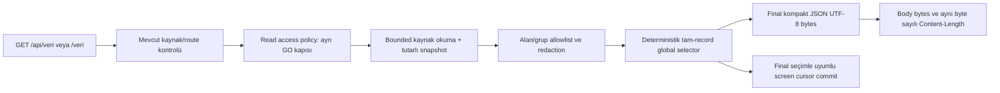

# Yuva #685 — Production GET global byte budget entegrasyon ve rollback taslağı

**Tarih:** 2026-10-23
**Durum:** Uygulama öncesi tasarım; production kodu/servis değişmedi.
**Karar:** Bu taslak host GO veya anonymous GET kabulü vermez. #574 tam anonim snapshot kararı NO-GO olarak kalır.

## Kaynak durum ve amaç

[#656](panel-get-snapshot-acceptance-656.md) verified fixture, gerçek panel `Handler` sınıfını kullanan bir test alt sınıfında `_gonder()` aşamasında selector çalıştırıp response body/`Content-Length`, partial metadata ve redaction sırasını sınar. Budget selector `prototypes/panel_snapshot_budget` içindedir; production `panel.server.H` bu selector'a bağlanmış değildir. Dolayısıyla #656 wire davranış fixture'ı production GET global budget kanıtı değildir.

[#606](panel-global-snapshot-budget-contract-606.md) nihai kompakt JSON/UTF-8 response için 8 MiB global tavanı, grup/item bütçeleri, sabit `snapshot_meta` ve `partial` sözleşmesini tanımlar. [#626](panel-snapshot-minimization-budget-audit-626.md) ise projection/redaction'ın bütçeden önce gelmesi gerektiğini, policy ile bütçe omission'ının ayrılmasını ve screen round-robin cursor'ının final global seçime bağlanmasını ister. Bu maddeler aşağıdaki production tasarımının girdileridir; mevcut production davranışı olarak varsayılmaz.

## Önerilen request-to-wire sırası

Her adım aynı `/api/veri` ve `/veri` handler'ından geçmelidir. GET erişim/authorization adımı selector'dan bağımsızdır; selector anonymous okuyucuya izin vermez ve mevcut GET erişim riskini kapatmaz.

### 1. Kaynak okuma ve snapshot

- `veri()` bugün tek kilitli okuma bölgesinde roster/task state'i birleştiriyor ve message/screen snapshot'ını oluşturuyor. Production selector bu projection'ın içeriğini değiştirmemeli ve diske yazmamalıdır.
- `durum.json`/`gorevler.json` için #606'da önerilen ham kaynak byte sınırları (4 MiB/16 MiB) parse öncesi uygulanmalı veya mevcut parser sınırlarının aynı garantiyi verdiği ayrıca kanıtlanmalıdır. Limit aşımı boş/partial success olmamalı; küçük sabit 503 olmalıdır.
- Bütçe dışarıda bırakılan kayıtları seçer; dosyadan tüm sınırsız girdiyi parse edip sonra budamak kesin process-memory tavanı değildir. Satır/item/source sınırları parse öncesi uygulanmalı, mevcut screen scan/parse/file/map limitleri korunmalıdır.
- Bozuk JSON, şema veya encoding kaynağı mevcut güvenli read-error davranışıyla hata yanıtına gitmeli; geçerli fakat boş snapshot gibi gösterilmemelidir.

### 2. Projection ve redaction sırası

Sıra **erişim/policy scope → alan/item allowlist projection → bilinen-pattern redaction → bütçe seçimi → final encoding** olmalıdır. Görev, mesaj veya screen içinde üretim allowlist'inin tanımadığı alanlar bütçeye dahi ulaşmamalıdır. Bilinen secret kalıbı redaction'ı bütün olası sırların temizlendiği anlamına gelmez.

#626 uyarınca policy nedeniyle kapsam dışı bırakılan bölüm/alan ile bütçeye sığmadığı için atlanan izinli kayıt ayrı anlam taşımalıdır. Tek `partial` biti anonim tüketiciye gizlilik politikasıyla gizlenen veri miktarını veya bölüm varlığını sızdırmamalıdır. Birden fazla consumer/scope gerekiyorsa ayrı response projection/schema seçilmelidir; aynı geniş response'u budget ile “summary” saymayın.

### 3. Global selector ve wire serialization

- Selector production `Handler`'a, response yazılmadan önce tam projected/redacted snapshot üzerinde bağlanır. Test-only subclass'taki monkeypatch/override production integration sayılmaz.
- #606'daki 8 MiB kesin tavan ancak ürün ve API sahipleri onayladıktan sonra production default'u olabilir; grup/item budget'ları da aynı sözleşme ve UI beklentileriyle versiyonlanmalıdır. Item kesilmez: bütçeye sığmayan tam kayıt atlanır, aynı grupta sonraki küçük kayıtlar değerlendirilir.
- Group/field tipleri korunur (`kullanicilar` map, `gorevler`/`mesajlar` array, `ekranlar` map); üst seviye `snapshot_meta` ek alanı `schema_version`, `partial`, final byte budget, dahil/atlanan sayılar ve sabit allowlist reason enum'ları taşır. Metadata ID, path, record text, exception veya serbest hata taşımaz.
- Final body tek kez `ensure_ascii=False`, compact separators ve `allow_nan=False` eşdeğeri serializer ile byte dizisine çevrilir. `_gonder()` aynı body'yi yeniden `json.dumps()` yapmamalı; bytes gönderme yüzeyi veya final encoded bytes'i koruyan response API'si kullanmalıdır. `Content-Length == len(final_body_bytes)` olmalıdır.
- Final byte invariantı aşılır veya metadata/header reserve sığmazsa tekrar serialize ederek budama yapılmaz; küçük sabit 503 body döner. Kaynak limitinde 503, bozuk/read failure'da güvenli 500, byte nedeniyle omission varsa 200 + `partial=true` sözleşmesi korunur.
- Source/read hatası ile bütçe omission'ı ayrıdır: okunamayan dosya veya kaynak tavanı normal partial sayılamaz. Sabit error body kendi küçük byte sınırında ve path-free olmalıdır.

### 4. UI ve istemci uyumluluğu

Server ve partial semantiğini anlayan UI aynı release/cutover içinde dağıtılmalıdır. Eski UI yeni metadata'yı görmezden gelip kısmi kullanıcı/görev listelerini tam liste sanabilir.

- `partial=true` iken adetler total olarak sunulmaz; eksik user/task listesinden yokluk, atama, çevrimdışı olma veya tamamlanma çıkarılmaz.
- Liste bütünlüğü isteyen yönlendirme/rol/görev mutation kontrolleri uygun grup partial iken kilitlenmeli veya hedefi ayrı doğrulamalıdır.
- `ekranlar_meta.partial` ile global screen omission tek doğru partial göstergesinde anlamlı biçimde birleştirilir; policy exclusion ayrı kapsam metadata'sıdır.
- Known external `/api/veri` consumer'ları ve `/veri` alias'ı envanterlenmeden partial response açılmaz. Üst alan eklemek JSON parse açısından additive olsa da davranışsal olarak eski istemciye uyum garantisi değildir.

## Screen cursor ve determinism

Mevcut `tum_ekranlar()` round-robin seçimini snapshot kurulurken ilerletebilir. Global budget daha sonra bir veya daha fazla dosyayı çıkarırsa cursor dışlanan dosyaları atlamamalıdır.

Uygulama ya reader'dan `(candidate, cursor_before, last_considered)` döndüren ve commit etmeyen bir arayüz almalı ya da screen seçim/bütçe işini tek selector içinde birleştirmelidir. Cursor yalnız final selection'ın değerlendirdiği son dosyaya kadar ve başarılı final encode/invariant kontrolü sonrasında commit edilir. Budget yüzünden çıkarılan dosyalar sonraki istekte yeniden aday olmalıdır. Selector hata verirse cursor değişmez.

Bu, final response seçimi ile cursor kararının uyumudur; istemcinin body'yi gerçekten teslim aldığını garanti etmez. Write/connection loss sonrası exactly-once screen delivery istenirse ayrı acknowledgement/receipt sözleşmesi gerekir; bu taslak ve mevcut GET API onu sağlamaz.

## Bellek sınırı: byte tavanı ≠ RSS tavanı

Final wire response için 8 MiB sınırı process heap'ini aynı değerde sınırlamaz. Kaynak JSON parse objeleri, projected kopyalar, item başına encode edilmiş bytes, seçilen group buffer'ları ve final body aynı anda bellekte bulunursa peak kullanım response tavanının katlarına çıkabilir. Mevcut fixture selector her adayı encode edip seçilen encoded parçaları tutar; doğrudan production'a taşımak tek başına bellek ispatı değildir.

Production tasarımı şu kapasite kapılarını ölçüp sınamalıdır:

1. Parse öncesi bounded source file bytes; JSON depth/record size/count sınırları ve error-before-partial davranışı.
2. Tek-item/tek-line/ekran dosya sınırları; mümkünse tek kayıt encode edilip budget kabul/ret kararı sonrası geçici referansı bırakılmalı.
3. Aynı anda tutulan input/projection/output kopyalarının üst sınırı ve çok byte'lı Unicode, escape ve büyük kayıtlarla peak RSS ölçümü.
4. Bounded screen page/scan/parse/output kaynak limitleri; selector son body'yi tek sefer kurup aynı byte buffer'ını response'a vermeli.
5. Kesin RSS üst sınırı gerekiyorsa ayrı memory-limited worker/streaming yaklaşımı ve host ölçümü. 8 MiB wire invariantı RSS/cgroup/OOM garantisi diye sunulmamalıdır.

Bellek kabulünde eşik ve deployment limiti product/host owner tarafından seçilmeden “production memory bounded” iddiası kurulmaz.

## Rollout ve rollback taslağı

### Pre-rollout kapıları

1. Data/security owner GET okuyucu kitlesini ve #574 tam anonymous snapshot NO-GO kararını çözer; production auth/access boundary veya onaylı ayrı minimal read model belirlenir. Bütçe erişim kontrolü değildir.
2. API/UI owner #606 schema ve partial davranışını onaylar; external consumer ve alias listesi tamamlanır.
3. Release owner production selector/byte sender/UI'yı tek temiz release'te bağlar; test-only fixture override production yolu olarak kullanılmaz.
4. Data owner projection/redaction allowlist'ini bütçeden önce kabul eder; #626 policy omission ve byte omission metadata semantiğini çözer.
5. Memory owner kaynak/item limits ve ölçümlü peak-memory kabulini belirler; sadece final body size yeterli sayılmaz.
6. Screen cursor race, final selector failure, source fail, metadata overflow, exact limit/limit+1 ve route aliases TemporaryDirectory/synthetic Handler fixture'ında kanıtlanır.
7. Host operator release hash, effective route, UI/server version, bind/access policy ve rollback target'ını ayrı kabul eder. Bu taslak host GO sağlamaz.

### Aşamalı yayın

- Production access kararı kapalıyken bütçe rollout'u başlatılmaz.
- Onay sonrası önce staging/canary release'te response schema, actual byte length/`Content-Length`, partial UI ve memory ölçümü gözlemlenir; üretim `YUVA_DIR` üzerinde sentetik olmayan test yapılmaz.
- Feature gate kullanılacaksa varsayılan ve config hatası davranışı explicit tasarlanır. Bütçe açıkken selector/config hatası sessizce limitsiz response'a dönmemelidir.
- Partial response gören tüketici metadata'yı yanlış yorumluyorsa veya byte/content-length/memory/cursor invariantı bozulursa rollout durur; yeni trafik/admission kapatılır.

### Geri alma

- Rollback yalnız exact önceki server+UI release ve onun GET erişim politikası kabul edilmişse yapılır. Eski sürüme dönmek, unbounded ve herkese açık hassas snapshot'a dönmek anlamına geliyorsa otomatik rollback **yasaktır**; hassas route'u kapat/servisi güvenli şekilde durdur ve owner kararı al.
- Selector feature gate kapatılıyorsa limitsiz legacy GET'e geçmeden önce tüm hassas GET alias'larına eşdeğer auth/access boundary uygulanmış olmalıdır. Aksi hâlde feature-off durumu production exposure'u artırabilir.
- Snapshot selection kaynak dosya, görev, mesaj veya ekran JSONL'ını değiştirmez. Cursor in-memory state'i resetlenebilir; selection result/readiness state'i dış veriye yazılmaz. Rollback data migration/restore veya release pointer değişimini bu taslak gerçekleştirmez.
- Partial sonucu release değişimi sırasında cache'te tutulmamalı; eski/new server karışık serving yapmamalı. Tam sürüm geçişi ve client-cache invalidation/reload planı olmalı.
- Bir response gönderimi/connection sonucu belirsizse selector/GET tekrarının sonucu idempotent read olabilir, fakat screen round-robin teslim exactly-once değildir; UI warning ve cursor davranışı bilinmeden “rollback tamam” denmemelidir.

## Production kabul matrisi

| Senaryo | Beklenen kanıt | Başarısızlık davranışı |
|---|---|---|
| `/api/veri` ve `/veri` aynı projected body contract | Exact route/status/body bytes, metadata ve `Content-Length` eşleşmesi | Fail-closed safe error; alias'a farklı limit yok |
| Redaction/allowlist ve bütçe sırası | Known sentinels seçici input'unda yok; unknown fields hiç serialize edilmez | Response başarısız; içerik sızdırmadan sabit hata |
| Exact byte limit ve limit + 1; Unicode/escape | Final encoded bytes gerçek tavanı geçmez; complete-record omission | Tavan invariantı bozulursa 503; kısmi JSON/body kırpma yok |
| Grup/item limitleri ve partial UI | Sabit array/map tipleri, doğru counts/reasons, incomplete listte mutasyon kilidi | UI partial'ı total/yokluk olarak yorumlamaz; uyumsuz client kabul edilmez |
| Kaynak boyutu/schema/read hatası | Pre-parse cap, status/error contract, source bytes değişmez | 503 kaynak limiti veya 500 read/schema; boş snapshot/partial başarı yok |
| Ekran budget ve cursor | Budget-dropped dosya sonraki çağrıda aday kalır; selector error cursor'ı ilerletmez | HOLD/unknown; dosya kaybı veya duplicate-free guarantee iddiası yok |
| Peak memory / response failure / rollback | Ölçümlü deployment kaynak sınırı ve accepted önceki UI/server/access config'i | Admission kapalı; unbounded legacy GET'e otomatik geri dönüş yok |

## Mevcut NO-GO sınırı

Bu taslak production kodunu, `panel.server.H`'ı, UI'ı, route'ları veya servisi değiştirmedi. Host, browser erişimi, `YUVA_DIR`, auth modu veya process memory ölçülmedi; test/runtime/rollout/rollback yapılmadı. #656 test-only Handler kanıtı production integration değildir. #574'ün anonim tam snapshot NO-GO kararı ve GET auth boşluğu devam eder. Bir sonraki uygulama işi ayrı yetkilendirilmiş kod/fixture görevinde yapılmalı; bütün pre-rollout kapıları geçmeden GO verilmemelidir.

## Kaynaklar

- `docs/panel-get-snapshot-acceptance-656.md` — verified test Handler wire budget fixture'ı ve production sınırı.
- `prototypes/panel_snapshot_budget/snapshot_budget.py` — fixture-only selector ve byte/schema sözleşmesi.
- `docs/panel-global-snapshot-budget-contract-606.md` — global byte/partial API tasarımı.
- `docs/panel-snapshot-minimization-budget-audit-626.md` — projection-before-budget, metadata ayrımı ve cursor commit riskleri.
- `docs/panel-anonymous-snapshot-data-minimization-574.md` — anonim tam snapshot NO-GO ve veri erişim sınırı.
- `panel/server.py`: `veri()`, `tum_ekranlar()`, `H._gonder()`, `H.do_GET()` — mevcut production snapshot/response yolları.
