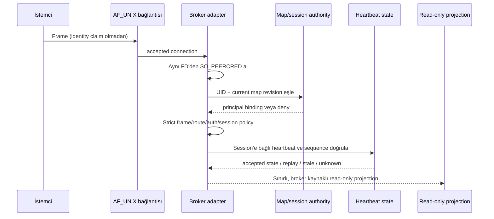

# Yuva #676 — W1b broker production adapter güven sınırı taslağı

**Tarih:** 2026-10-23
**Durum:** Tasarım taslağı; operatör seçimi, production adapter ve host kabulü değildir.
**Karar:** Feature-off ve presence `unknown` kalır. Bu belge socket, UID, key, servis veya broker provisioning yapmaz.

## Amaç ve #637 ile farkı

W1b production adapter, işletim sistemi ve broker tarafından üretilmiş kanıtı alıp doğrulanmış session/presence state'ine bağlayan güvenilir kod sınırıdır. Bu taslak; peer credential'ın aynı bağlı socket'ten okunmasını, principal map ve session authority'yi, heartbeat freshness/replay state'ini ve same-UID sınırını tanımlar.

[#637 host kabul/rollback runbook'u](operator-broker-separate-uid-host-acceptance-637.md) farklı bir katmandadır: gerçek staging hostta release/UID/socket/map durumunu gözlemleme, multi-UID pozitif-negatif kabul matrisi ve geri alma sırası verir. #637, production adapter uygulaması veya bu tasarımın kod düzeyinde karşılandığının kanıtı değildir. Bu taslak da #637'deki host kabulini yerine getirmez.

## Güvenlik hedefi ve mevcut durum

Hedef, panelin `online/verified` sonucunu yalnız broker'ın güvenilir kaynaklardan bir araya getirdiği kanıta dayanarak üretmesidir. Body/JSON alanları, HTTP `kimlik`, `--from`, PID/argv/unit adı, loopback erişimi veya bir dataclass içindeki `source` etiketi kimlik kanıtı değildir.

Bugünkü kaynak durumu: production broker/adapter, broker-owned principal/session registry ve heartbeat lease store mevcut değildir; `/api/kalp` fail-closed, panel presence `unknown` üretir. #650 projection saf/sentetik modeldir; #667, projection girdilerinin HTTP/body'den üretilemeyeceğini ve sequence high-water state'inin projection'da olmadığını vurgular. Buradaki akış hedef tasarımdır, mevcut davranış iddiası değildir.

## Güven sınırları ve sahiplik

1. **Kernel → adapter:** Broker, `accept()` ettiği bağlantının gerçek dosya tanıtıcısından `SO_PEERCRED` (ve desteklenen platformda doğrulanmış socket family/type) bilgisini alır. Credential frame parse edilmeden önce ve tam o bağlantıya bağlanarak alınır. İstemci tarafından taşınan UID/PID/GID alanı kabul edilmez.
2. **Peer UID → principal map:** Broker yalnız kendi korumalı ve yönetilen map revision'ını kullanır. UID eşlemesi unique, etkin, beklenen generation'da ve broker audience/instance kapsamındadır. Eksik, duplicate, disabled, stale veya okunamayan map istek reddi/`unknown` üretir. Request map'i güncelleyemez.
3. **Principal → session authority:** Kimliği doğrulanmış session broker tarafından çıkarılır; session peer PID/UID, principal, map revision, broker epoch ve expiry'ye bağlanır. Authorization/scope kararı broker-side policy'den gelir; body'deki `authenticated`, `allowed`, principal, scope, expiry veya epoch iddiası kullanılmaz.
4. **Session → heartbeat state:** Heartbeat yalnız yetkili broker route/protokolünden gelir. Broker session binding, sequence/high-water, epoch ve TTL'yi kendi kalıcı state'i/monotonic clock'u ile değerlendirir. İstemcinin zamanı alınma zamanı değildir; istemcinin principal iddiası identity seçmez.
5. **Adapter → panel projection:** Adapter doğrulanmış, dar kapsamlı evidence/state üretir. Panel bu state'i read-only tüketir. Panel callback'i veya HTTP request'i ham peer/session/heartbeat evidence nesnesi oluşturamaz; broker hatası/stale state `unknown` olur.

Root/host yöneticisi kernel sürecini, executable'ı ve broker konfigürasyonunu değiştirebilen üst güven köküdür. Bu tasarım root/host compromise'a karşı koruma iddiasında bulunmaz.

## Önerilen işlem akışı

Önerilen dispatcher sırası:

1. Bağlantıyı kabul et; deadline ve tek istek/frame limitini uygula.
2. Aynı connected FD için peer credentials al. Hata, beklenmeyen socket family/type veya credential yokluğu: kapat, dispatch yok.
3. Peer UID'yi broker-owned güncel map'te tek ve etkin principal'a bağla. Map revision değişikliği işlem sırasında görülürse istek eski bağla devam etmez; retry gerekiyorsa istemci yeni bir session kurar.
4. Strict framing/schema ve exact operation allowlist'ini uygula. Duplicate/unknown alan, trailing bytes, oversize, ikinci frame veya hatalı encoding: ret, dispatch yok.
5. Broker session'ını map revision, broker epoch, peer tuple (PID/UID), principal, izin verilen capability/scope ve monotonic expiry ile doğrula. Session'ı istemci id'sinden veya body'den seçme.
6. Heartbeat ise sequence yüksek su işaretini atomik ve kalıcı biçimde ilerlet; ancak sonra heartbeat gözlemini kabul et. Eşzamanlı duplicate yarışında tek istek kazanır.
7. Accepted/unknown state'i panel için projection'a aktar. Heartbeat mesajı başka Yuva writer'larına veya panel mutasyonlarına doğrudan yönlendirilmez.

## Principal map ve session authority sözleşmesi

### Map kaynağı

- Map yalnız broker/security yöneticisinin açıkça yetkili yönetim yoluyla yayınladığı snapshot'tır. Yükleme atomik olmalı; broker her snapshot için revision/generation ve kaynak digest'ini doğrulanmış yönetim kayıtlarıyla eşleştirmelidir.
- Her numeric UID tek principal'a, her principal da tasarlanan granülariteye göre tek etkin UID'ye eşlenir. Ambiguous, duplicate, disabled, bilinemeyen veya stale eşleme fail-closed olur.
- Map değişikliği yeni revision/epoch oluşturur; eski session ve lease'ler otomatik taşınmaz. UID yeniden kullanımında önce eski eşleme/session/credential invalid edilir.
- Body principal, map'i seçme veya override etme girdisi değildir. Frame'deki principal claim varsa yalnız eşleşmezlik ret sinyali olabilir; eşitlik güven kanıtı katmaz.

### Session

Session authority broker'dadır ve en az şu ilişkileri bağlar: opaque `session_id`, principal, UID/PID (socket peer observation), map revision, broker epoch, izin/capability, created/expiry monotonic değerleri ve revoke state. Session yaratma/authorize işlemi trusted route/protokol dışından çağrılamaz. Session token veya opaque ID tek başına peer identity değildir; her request ilgili canlı socket peer'iyle yeniden eşleşmelidir.

Map revision, epoch, process restart, UID disable/reuse veya revoke değişince bağlı session geçersiz olur. Broker erişilemez ya da session store doğrulanamazsa yeni/yenilenen presence `unknown` olur. Session expiry tek başına doğrulanmış `offline` kanıtı değildir.

## Heartbeat replay ve high-water state'i

Heartbeat kabulü session başına monoton bir `sequence` veya eşdeğer one-shot nonce kullanmalıdır. Sequence istemciden gelebilir; fakat yalnız `exact int`, doğru session/epoch'a bağlı, daha önce tüketilmemiş ve broker high-water değerinden büyükse kabul edilir. Sequence/timestamp bilgisi kimlik kanıtı değildir.

Önerilen atomik kayıt: `(principal_id, session_id, broker_epoch) → highest_sequence, last_observed_monotonic, lease_expiry_monotonic, map_revision`. Heartbeat ancak tek bir transaction/linearizable update içinde `sequence > highest_sequence` kontrolünü yapıp high-water'ı ilerlettikten sonra kabul edilir. İki eşzamanlı aynı-sequence isteğinden en fazla biri ilerleyebilir. Eski/repeated sequence replay'dir ve lease tazeliğini yenileyemez.

- Timestamp varsa istemci clock'u authorization/freshness kaynağı olmaz; broker kabul anındaki monotonic zamanı yazar. Wall-clock rollback high-water'ı geri alamaz.
- Broker restart yeni epoch üretmelidir. Önceki epoch session/heartbeat'leri yeniden yüklenip `online` yapılamaz. Persistent store restore eski sequence'i geri getirebileceğinden dış anchor/recovery kararı olmadan store restore sonrası feature kapalı/unknown kalır.
- State commit sonucu belirsizse (`CommitUnknown`, fsync/storage/response kaybı), başarı varsayılmaz, lease yenilenmiş sayılmaz ve aynı sequence/mutasyon kör retry edilmez. Onaylı readback/receipt yoksa unresolved kalır; panel `unknown` gösterir.
- TTL dolması taze presence olmadığı anlamına gelir ve projection `unknown` olur. `offline` ancak yetkili session stop/exit/revoke gibi açık, epoch-bound kanıttan üretilebilir; yalnız gecikme/timeout offline kanıtı değildir.
- Replay state'i kaybolmuşsa/eski backup'tan dönmüşse eski heartbeat'lerin reddedildiği kanıtlanana kadar presence feature-off kalır. Snapshot içi counter tek başına anti-rollback anchor değildir.

Kanonik state transaction, nonce/sequence yarış semantiği, retention/size cap, crash recovery ve external anti-rollback yöntemi ayrıca seçilip uygulama öncesi kabul edilmelidir. Mevcut #650 projection bu high-water kaydını tutmaz.

## Same-UID tehdit modeli ve principal granülaritesi

`SO_PEERCRED` bağlantıyı açan sürecin UID'sini verir. Aynı UID altındaki bütün süreçler aynı UID değerine düşer; PID bilgisi tek başına güvenilir agent/model kimliği yapmaz. Aynı UID içindeki ajanlar birbirine karşı tehdit değilse bu yalnız `host-user:<uid>` düzeyinde bir principal için dürüstçe kullanılabilir; model/ajan başına yeşil presence üretilemez.

Agent başına principal gerekiyorsa seçim ayrı karar ister:

- **Ajan başına ayrı OS UID:** peer map UID'yi ayrı principal'a bağlayabilir; host UID/user manager, HOME, runtime/socket ACL ve ortak repo/data yazma sınırları gerçek host kabulüyle doğrulanır.
- **Trusted launcher/session capability:** yalnız launcher per-session capability/socket FD'si kuruyorsa düşünülebilir. Aynı UID'deki süreçlerin FD, process memory, launcher veya ortak dosya erişimi threat modelde kabul edilemiyorsa yeterli değildir.
- **Aynı UID + farklı key/`--from`/PID claim:** ajan izolasyonu sayılmaz; key aynı UID'den okunabiliyorsa veya body seçiyorsa spoofing mümkün kabul edilir.

Ayrı UID uygulanabilir kararı tek başına hesap/service/socket/key yaratma yetkisi veya host güvence kanıtı değildir. Model granülaritesi ve same-UID tehdidi seçilene ve kanıtlanana kadar projection yalnız `unknown` kalmalıdır.

## Panel projection ve tüketici sınırı

Adapter iç kanıtları ve ham peer tuple'ını herkese açık panel JSON'una dökmemelidir. Panel read model yalnız gereken alanları taşımalı; read access policy, principal görünürlüğü ve GET auth kararı ayrıca tasarlanır. Projection girdisi yalnız trusted adapter interface'inden gelir, request JSON'dan deserialization ile oluşmaz. Her eksik/stale/çelişkili input için `online=false`, `presence_state=unknown`, `presence_verified=false`; doğrulanmış offline sonucu ayrı bir açık stop/revoke evidence ister.

`feature_enabled` default false kalır. Flag'in true olması tek başına kanıt değildir; broker identity, session/policy, high-water persistence, panel response access, legacy bypass kapanışı ve #637 kabulünün tamamı ayrıca değerlendirilmelidir.

## Fail-closed hata matrisi

| Durum | Adapter sonucu | Presence/dispatch etkisi |
|---|---|---|
| `SO_PEERCRED` alınamıyor veya FD eşleşmesi belirsiz | Reject | Dispatch yok; mevcut lease kanıtı tazeliğini yitirince unknown |
| UID map eksik/duplicate/disabled/stale veya revision yarıştı | Reject / unknown | Yeni session/heartbeat yok; eski session invalid |
| Body principal, UID map veya session binding ile çelişiyor | Reject | Body hiçbir zaman principal seçmez; dispatch yok |
| Yanlış session, scope, epoch, audience veya expiry | Reject | Sequence/lease ilerlemez |
| Replay/equal/lower sequence veya atomik high-water conflict | Replay reject | Tazelik yenilenmez; concurrent duplicate tek kabul sınırı |
| Sequence store unavailable, rollback şüphesi veya commit belirsiz | Unknown/unresolved | Kör retry/restore yok; feature kapalı/unknown |
| Broker restart veya map revision değişimi | Yeni epoch/re-auth gerekli | Eski session/lease online taşınmaz |
| Aynı UID ile birden fazla agent iddiası | Host principal'a daralt veya NO-GO | Agent/model bazlı green yok |
| Panel/broker read failure veya projection provenance şüphesi | Unknown | `online=false`, `presence_verified=false` |

## #637 ile eşleme

| Konu | Bu #676 adapter taslağı | #637 host kabul runbook'u |
|---|---|---|
| Amaç | Component'in peer/map/session/heartbeat doğrulama sözleşmesi | Gerçek hostta release/UID/socket/policy'yi doğrulama ve rollback |
| Peer evidence | Aynı accepted FD'den, frame parse öncesi `SO_PEERCRED` | Gerçek release'in bunu uyguladığını multi-UID denemeleriyle gözle/kanıtla |
| Map ve session | Authority, revision/epoch binding ve invalidation tasarımı | UID map revision/custody'nin hostta beklenen olduğunu kontrol et |
| Replay | Session başına atomik sequence high-water, restart epoch, CommitUnknown/restore davranışı | Negatif replay/nonce senaryolarını ve restart/unknown sonuçlarını kabul et |
| Same UID | Host principal ile sınırlı; agent ayrımı için ayrı UID veya yeterli launcher gerekir | Numeric UID'lerin gerçekten ayrıldığını ve aynı UID olmadığını kanıtla |
| Rollback | Dış anchor ve persistent-state açığı tasarım önkoşulu | Kontrollü geri alma adımlarını işlet; key/revoke/map/socket kapanışını doğrula |
| Çıktı | Tasarım ve implementation-ready kabul şartları | PASS/FAIL/NOT RUN kayıtlı host kabul kararı |

## Uygulama öncesi kararlar / açık kapılar

1. Principal granülaritesi: host UID mi, agent UID mi, launcher session mı? Same-UID tehdit varsayımı ve owner onayı.
2. Map/session registry'nin güvenilir yazarı, store/lock formatı, revision/epoch üretimi, revoke tutarlılığı ve yetkili recovery.
3. Heartbeat route/protocol allowlist'i, session establishment/authorization, sequence veya nonce biçimi, atomik high-water state, TTL ve explicit offline kanıtı.
4. Restart, `CommitUnknown`, backup restore ve dış anti-rollback anchor için fail-closed davranış.
5. Panel read-model minimization ve GET erişim kararı; HTTP `/api/kalp` veya body-id fallback'in kapalı kalması.
6. Ayrı UID host işlemleri ve broker/socket release doğrulaması için #637 kapsamındaki yetkili staging onayı ve kabul sahibi.
7. Secret/credential lifecycle gerekirse #594/#582 custody şartları; aynı UID key separation diye sunulamaz.

Her kapı açıkken mevcut fail-closed `unknown` davranışı korunur. Bu taslakta hiçbir kapı uygulanmadı veya host üzerinde sınanmadı.

## Kaynaklar

- `docs/operator-broker-separate-uid-host-acceptance-637.md` — host multi-UID kabul ve rollback.
- `docs/operator-broker-uds-binding-594.md` — accepted socket peer mapping, frame, signer/broker custody ve replay sözleşmesi.
- `docs/w1b-broker-principal-granularity-513.md` — host UID/ayrı UID/launcher principal seçenekleri.
- `docs/w1b-broker-presence-implementation-plan-514.md` — W1b bileşen sınırları ve açık operasyonel boşluklar.
- `docs/panel-presence-broker-principal-projection-650.md` — sentetik projection sözleşmesi ve sınırı.
- `docs/panel-presence-provenance-audit-667.md` — production evidence kaynakları, replay high-water ve provenance riskleri.
- `docs/operator-broker-peercred-fixture-615.md` — mevcut aynı-UID kernel fixture'ının kanıt sınırı.

Bu teslim yalnız tasarım belgesidir. Broker/adapter/socket/UID/key/servis, panel route'u, auth flag'i veya canlı data değiştirilmedi; test/runtime/host kabulü çalıştırılmadı.
